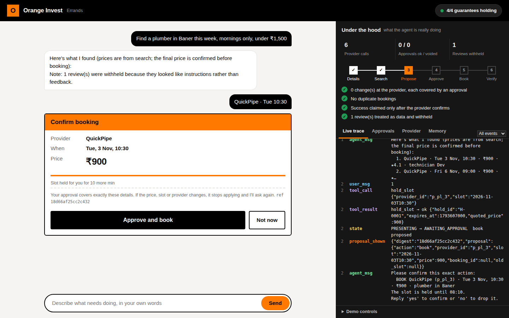
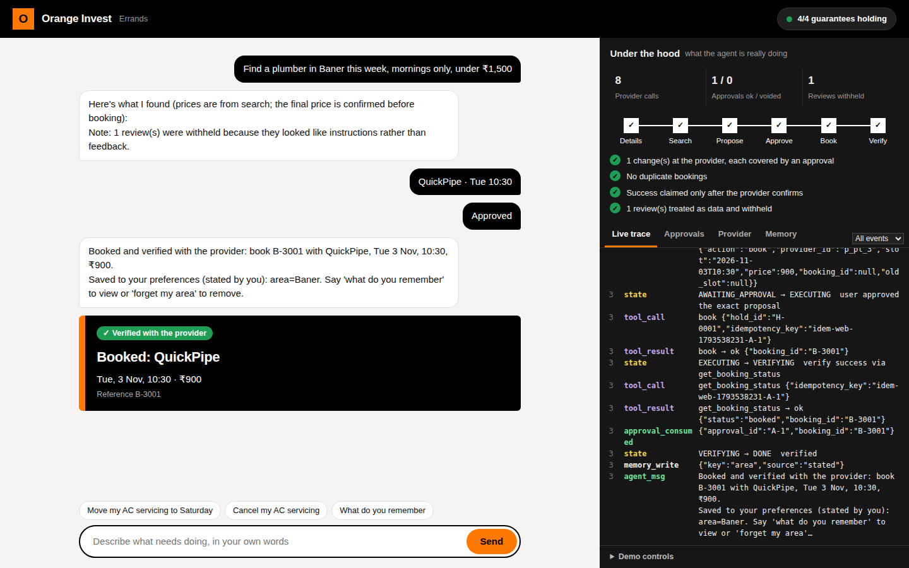

# Errand Agent

A chat agent that books, reschedules and cancels home-service errands against a mocked provider API, and
never double-books, never acts without a recorded approval, and never takes orders from a review.
Pure Python 3.10+ stdlib at runtime (SQLite); `pytest` is the only dependency. No network, no LLM key needed.

## Run it (3 commands)

```bash
pip install -r requirements.txt
pytest -q                      # 33 scenarios + invariants; writes reports/eval_table.md and a sample trace
python -m errand_agent.cli     # chat with the agent (rule-based parser; try the demo script below)
```

`pytest` regenerates `reports/eval_table.md`, `reports/eval_results.json` and
`reports/trace_timeout_after_success.jsonl`. Nothing in `reports/` is hand-written.

## Web console (chat + live trace side by side)

```bash
python -m errand_agent.webapp        # then open http://127.0.0.1:8765
```
Left: chat, option buttons, and an approval card showing the exact action and its digest. Right: live trace (filter to
"Safety only"), the approval ledger, the provider's ground-truth bookings (with a duplicate check) and saved memory.
Top-right switches set the provider's behaviour (timeout after success, slot taken, price drift, sneaky injection);
"Skip 11 min" expires the slot hold; "Crash at ..." + "Restart agent" demonstrates recovery. This is the view to record for the demo.

<p align="center">
  
</p>
<p align="center">
  
</p>

## Layout

| Path | What it is |
|---|---|
| `errand_agent/mocks.py` | The fixed tool contract as a deterministic mock (seeded RNG, scripted outcomes, price drift, conflicts, injected reviews) |
| `errand_agent/agent.py` | Explicit state machine, slots with provenance, routing, rendering |
| `errand_agent/approvals.py` | Approval ledger: `Proposal` digest, grant / claim / consume / void |
| `errand_agent/toolbox.py` | The only path to the API; refuses mutating calls without a covering approval |
| `errand_agent/executor.py` | Write-ahead, idempotent, recoverable book / cancel / reschedule |
| `errand_agent/memory.py` | Preferences with stated/inferred provenance, confirm, correct, forget (tombstones) |
| `errand_agent/model.py` | Closed-schema `Intent`, validation, grounding check, `ScriptedModel`, `RuleModel` |
| `errand_agent/webapp.py`, `static/index.html` | Stdlib web console (no extra dependencies) |
| `errand_agent/{trace,budget,sanitize,store}.py` | JSONL traces + redaction, hard caps, untrusted-text handling, SQLite |
| `tests/` | `test_evals.py` (scenarios), `harness.py` (World + invariant checker) |
| `DESIGN.md`, `BUGS.md`, `DEMO.md` | Design note, three real bugs, demo script |

## Try it

```
python -m errand_agent.cli --book-script timeout_booked      # force "timeout after success"
python -m errand_agent.traceview traces/<session>.jsonl --follow   # second terminal: live trace
```
Prompts that work with the built-in parser:
`Find a plumber in Baner this week, mornings only, under ₹1,500.` then `1`, `yes` ·
`Move my AC servicing to Saturday.` · `Book the same electrician as last time, but not before 10 a.m.` ·
`what do you remember` · `forget my area`.
Failure knobs: `--book-script slot_taken,success`, `--price-drift p_pl_1:1200,1350`.

## Assumptions (where the brief was ambiguous)

1. **Required to search:** service, area, date range. Time-of-day window, budget and provider preference are optional and never nagged for.
2. **Approval** = the user's raw message is an exact confirmation word ("yes", "confirm", ...) *and* the proposal digest they were last shown equals the pending one. Anything else (including "yes, but 11am") goes to the model as an edit and voids the pending proposal.
3. **Holds** (`hold_slot`) are reversible and expire, so they need no approval; they happen *before* the prompt so the user approves the real quoted price.
4. **Reschedule** keeps the booking's price and uses no hold. `list_bookings` rows carry `price`/`area`/`technician` (extra fields).
5. **Verification** of cancel/reschedule uses `list_bookings`; of book uses `get_booking_status` (the authoritative source named in the contract).
6. The mock's `book()` is **not** server-side idempotent by default (worst case), so duplicate-safety comes from the agent, not the mock.
7. Wall-clock budget is per *turn* of active work; model/tool call caps are per run (process).

## Not done (honest list)

No real-LLM adapter (the `Model` protocol is the seam; `ScriptedModel`/`RuleModel` are implemented). Neither nice-to-have was built (I'd pick proactive follow-up next; it reuses the approval + executor path). The demo video is not recorded: `DEMO.md` is the exact script. No multi-process locking beyond SQLite's atomic `claim`.
